# Thiết Kế Mô Hình Dữ Liệu Đa Chiều (Star Schema ERD)

Dự án áp dụng phương pháp luận thiết kế kho dữ liệu chuẩn công nghiệp của Ralph Kimball (Dimensional Modeling) nhằm tối ưu hóa hiệu năng truy vấn phân tích (OLAP) và tạo điều kiện thuận lợi nhất để xây dựng Dashboard trên Power BI, Tableau hoặc Excel.

---

## 1. Sơ Đồ Thực Thể - Quan Hệ (ERD Diagram)

```mermaid
erDiagram
    dim_date ||--o{ fact_game_metrics : "records metrics on"
    dim_games ||--|| fact_game_metrics : "measures performance of"
    dim_date ||--o{ dim_games : "releases on"

    dim_games ||--o{ bridge_game_genres : "categorized by"
    dim_genres ||--o{ bridge_game_genres : "contains"

    dim_games ||--o{ bridge_game_categories : "supports"
    dim_categories ||--o{ bridge_game_categories : "contains"

    dim_games ||--o{ bridge_game_developers : "developed by"
    dim_developers ||--o{ bridge_game_developers : "creates"

    dim_games ||--o{ bridge_game_publishers : "published by"
    dim_publishers ||--o{ bridge_game_publishers : "releases"

    dim_games ||--o{ bridge_game_tags : "tagged with"
    dim_tags ||--o{ bridge_game_tags : "applied to"

    dim_date {
        int date_id PK
        string full_date
        int year
        string quarter_name
        string month_name
        string month_year
        int day_of_month
        string day_name
        int is_weekend
    }

    dim_games {
        int appid PK
        string name
        int release_date_id FK
        int is_free
        float price_usd
        string price_tier
        string platform_support
        int has_vietnamese
        int has_english
        string primary_genre
        string primary_developer
        string primary_publisher
        string header_image
    }

    dim_genres {
        int genre_id PK
        string genre_name UK
    }

    dim_categories {
        int category_id PK
        string category_name UK
    }

    dim_developers {
        int developer_id PK
        string developer_name UK
    }

    dim_publishers {
        int publisher_id PK
        string publisher_name UK
    }

    dim_tags {
        int tag_id PK
        string tag_name UK
    }

    bridge_game_genres {
        int appid PK,FK
        int genre_id PK,FK
    }

    bridge_game_categories {
        int appid PK,FK
        int category_id PK,FK
    }

    bridge_game_developers {
        int appid PK,FK
        int developer_id PK,FK
    }

    bridge_game_publishers {
        int appid PK,FK
        int publisher_id PK,FK
    }

    bridge_game_tags {
        int appid PK,FK
        int tag_id PK,FK
        int vote_count
    }

    fact_game_metrics {
        int fact_id PK
        int appid FK
        int release_date_id FK
        float price_usd
        int total_reviews
        float positive_ratio_pct
        string review_score_tier
        float metacritic_score
        int estimated_owners_avg
        float estimated_revenue_avg_usd
        int peak_ccu
        float avg_playtime_forever_hours
    }
```

---

## 2. Bản Chất Các Mối Quan Hệ (Cardinality & Modeling Rules)

1. Quan hệ 1 - 1 (One-to-One):
   - `dim_games` (1) <---> `fact_game_metrics` (1): Mỗi tựa game duy nhất có đúng 1 dòng lưu trữ các chỉ số hoạt động kinh doanh tổng hợp.
2. Quan hệ 1 - Nhiều (One-to-Many):
   - `dim_date` (1) <---> `fact_game_metrics` (N): Một ngày lịch có thể có nhiều game được phát hành.
   - `dim_date` (1) <---> `dim_games` (N): Tương tự cho ngày phát hành game.
3. Quan hệ Nhiều - Nhiều (Many-to-Many via Bridge Tables):
   - 1 Game có thể thuộc nhiều thể loại (`dim_genres`), và 1 thể loại chứa hàng ngàn game. Cầu nối là `bridge_game_genres`.
   - Tương tự với tính năng (`dim_categories`), nhà phát triển (`dim_developers`), nhà phát hành (`dim_publishers`) và thẻ cộng đồng (`dim_tags`).

---

## 3. Lựa Chọn Sử Dụng Cho Dashboard (Power BI / Tableau)

- Cách 1: Kéo thả Bảng phẳng duy nhất (Khuyến nghị cho Dashboard nhanh):
  - Sử dụng tệp `data/processed/parquet/flat_steam_games_bi.parquet` hoặc view `vw_steam_games_dashboard`.
  - Không cần thiết lập mối quan hệ trong Data Model. Kéo thả các Slice và Metric có sẵn.
- Cách 2: Sử dụng Full Star Schema (Khuyến nghị cho Dashboard chuyên sâu):
  - Kết nối SQLite database `data/processed/steam_dw.db`.
  - Thiết lập mối quan hệ theo sơ đồ ERD ở trên với Cross-filter direction phù hợp để phân tích lọc chéo đa chiều.
